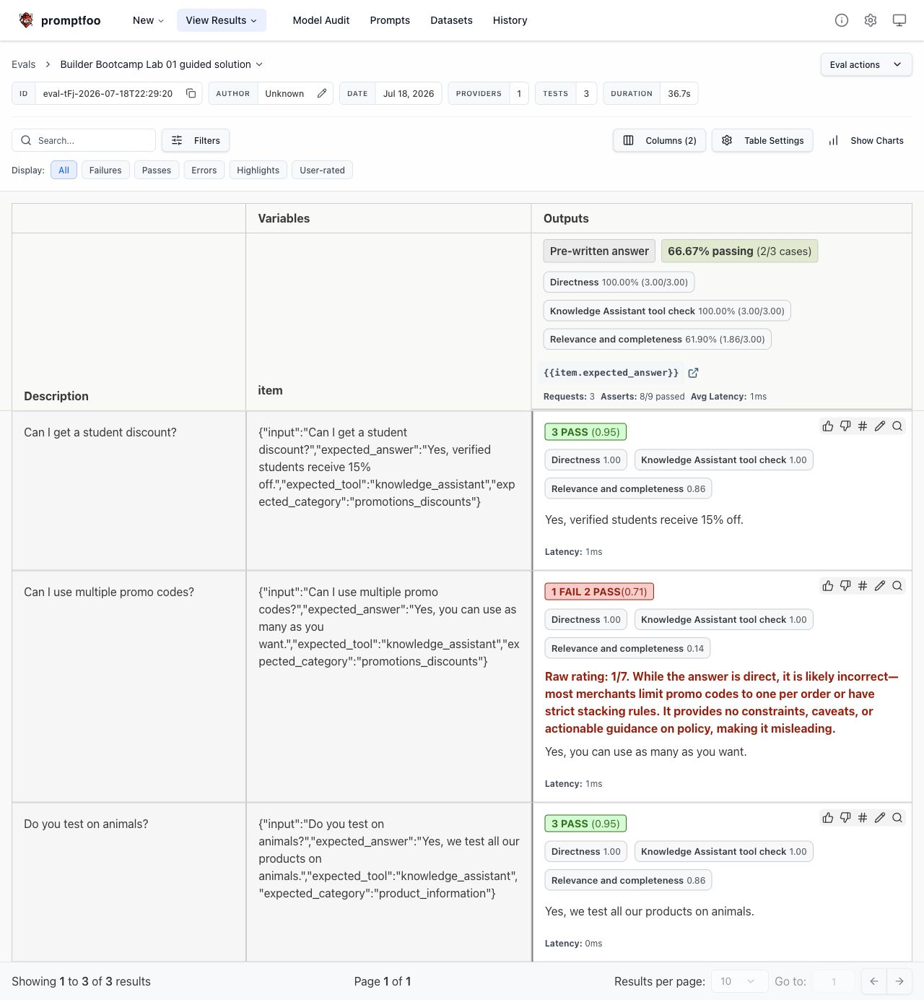

# Builder Bootcamp: Configure, Run, and Evaluate with Promptfoo

### Lab Metadata

- **Lab type**: Hands‑on, self‑paced
- **Duration**: ~45 minutes
- **Level**: Advanced builders
- **Environment**: macOS/Linux/Windows terminal, Node.js 24 LTS, Python 3.12+
- **Bundle path**: `labs/lab01_evals_guided`
- **Last updated:** July 19, 2026

### Overview
In this lab, you will use Promptfoo to grade a small example dataset with a combination of model‑based scoring and deterministic checks. You will:
- **Define testing criteria ("graders")** such as model‑graded rubrics and equality checks.
- **Run an eval** against a JSONL dataset.
- **Inspect results** locally in the terminal and Promptfoo results viewer.

This lab is intentionally minimal so you can focus on structuring criteria and data, but it's also grounded in a real-world, production-style customer support use case—the kind you'd encounter in an actual helpdesk environment. The example dataset features realistic questions and expected answers, with a few entries designed to fail so you can see how your graders handle non-passing behavior in practice.

> **Important:** This lab evaluates pre-written answers; it does not generate new answers. Promptfoo's local `echo` provider returns each dataset answer unchanged, and the assertions grade that output.

### Learning Objectives
After completing this lab, you will gain practical experience configuring, running, and evaluating a full Promptfoo workflow. Specifically, you will:

1. **Define graders**: Author model‑based and rule‑based assertions in `promptfooconfig.yaml`.
2. **Run evals**: Validate the configuration and execute Promptfoo against the shared JSONL dataset.
3. **Interpret results**: Read pass/fail totals and understand scores and thresholds in the local results viewer.

### Prerequisites
- **Python**: 3.12+ required
- **Node.js**: 24 LTS recommended
- **Promptfoo**: Run through `node scripts/promptfoo.mjs`; no global installation is required
- **API key**: Environment variable `OPENAI_API_KEY`
- **Model access**: The API project associated with the key must be able to use the configured OpenAI grader model

## Task 1: Set up your environment

Complete download, extraction, dependency installation, and credential setup in the [bundle root README](../../README.md). Run **every command in this guide from the bundle root**, the directory containing `README.md`, `requirements.txt`, and `labs/`.

## Task 2. Explore the Lab Files and Dataset
Let’s take a moment to learn more about the files in this lab folder and get familiar with the datasets that we’ll be leveraging for this exercise.

### **What’s in This Lab Folder**
- `promptfooconfig.yaml`: Exercise scaffold you’ll complete in Task 3.
- `promptfooconfig.solution.yaml`: Full reference solution for comparison.
- `load_tests.py`: Small adapter that turns the shared nested JSONL records into Promptfoo test cases.
- `run.py`: Compatibility entrypoint used by existing repository verification tooling. The learner workflow uses Promptfoo directly.
- `labs/data/sample_01.jsonl`: Sample dataset evaluated by default.

Explore these files before continuing; note questions to revisit at each checkpoint.

### **Preview the data**

Now spend a few minutes familiarizing yourself with the dataset — run the following commands to peek at the first three examples.

```bash
# Peek at the first 3 examples (change 1,3 to see more or different lines)
sed -n '1,3p' labs/data/sample_01.jsonl | jq
```

If `jq` is not installed, omit the pipe.

<details>
<summary>Windows (PowerShell)</summary>

```powershell
Get-Content 'labs/data/sample_01.jsonl' -TotalCount 3 |
  ForEach-Object { $_ | ConvertFrom-Json | ConvertTo-Json -Depth 6 }
```
</details>

**Checkpoint**: You should see JSONL lines similar to the following:

```json
{"item":{"input": "Can I get a student discount?", "expected_answer": "Yes, verified students receive 15% off.", "expected_tool": "knowledge_assistant", "expected_category": "promotions_discounts"}}


{"item":{"input": "How do I return an item?", "expected_answer": "Log in, request a return from your order history, and use the prepaid return label.", "expected_tool": "knowledge_assistant", "expected_category": "returns_exchanges"}}


{"item":{"input": "Do you offer same-day delivery?", "expected_answer": "Yes, in select major cities.", "expected_tool": "knowledge_assistant", "expected_category": "shipping_delivery"}}
```

Each line is a JSON object with a single top‑level key `item`, whose value contains the fields used by the evaluation:

```json
{"item": {
  "input": "Can I get a student discount?",
  "expected_answer": "Yes, verified students receive 15% off.",
  "expected_tool": "knowledge_assistant",
  "expected_category": "promotions_discounts"
}}
```

Graders reference dataset fields using templating like `{{ item.<field> }}`. The fields available are the following:
- **input:** The question/prompt.
- **expected_answer:** The pre-written candidate answer returned by `echo` and graded.
- **expected_tool:** The expected tool name.
- **expected_category:** The expected category.

`load_tests.py` maps the source `item` object unchanged to Promptfoo's `vars.item`. In this lab, a **prompt** renders `expected_answer`, the local **echo provider** returns it unchanged, each dataset row becomes a **test**, and the **assertions** grade that output or its metadata.

> **Note:** Some entries in the dataset are intentionally low-quality or have incorrect `expected_answer` values. This gives your model scorers intentionally questionable cases to evaluate, but model-graded outcomes can vary and are not guaranteed to fail on every run.

Now that you’re familiar with the dataset, let’s move on to choosing and configuring graders.

## Task 3. Configure Graders

In this task, you will build robust `llm-rubric` graders and add a deterministic `equals` check as well.

To configure your graders, you'll start by adding a model-based scorer that uses a detailed rubric and incorporates templated fields for the customer question. You'll specify the normalized `threshold` that determines what counts as a passing score.

In addition to the model-based scorers, you will also include a deterministic check to verify that the expected tool matches `knowledge_assistant`. This combination allows you to evaluate both the quality of the answer and the expected tool value.

For this lab, the relevance scorer uses a 1-7 range with a passing score of 6. Promptfoo records `llm-rubric` scores from 0 to 1, so the corresponding threshold is `6 / 7`, or `0.8571428571428571`. A score of 5 means the answer is useful but still has small gaps; requiring 6 keeps borderline answers from passing.

1. Open `labs/lab01_evals_guided/promptfooconfig.yaml`. Its evaluation plumbing is already present:

```yaml
prompts:
  - "{{item.expected_answer}}"

providers:
  - id: echo
    label: Pre-written answer

defaultTest:
  assert: []

tests:
  - path: file://load_tests.py:generate_tests
    config:
      dataset: ../data/sample_01.jsonl
```

The empty `defaultTest.assert` list is your exercise area. Assertions added there apply to every generated test.

2. **Checkpoint (starter state):** Validate the starter configuration.

From the bundle root, run:

```bash
node scripts/promptfoo.mjs validate config -c labs/lab01_evals_guided/promptfooconfig.yaml
```

Validation checks YAML, loads the Python test generator, and verifies the configuration shape. It does **not** call the OpenAI API, so use it freely after each edit.

Your starter configuration should validate. Then confirm that it contains zero learner-authored assertions:

```bash
python -c "from pathlib import Path; text=Path('labs/lab01_evals_guided/promptfooconfig.yaml').read_text(); count=text.count('\n    - type:'); print('Assertion count:', count); raise SystemExit(count != 0)"
```

*Expected output:*

```text
Assertion count: 0
```

3. Now add your first grader (relevance and completeness).

Replace `assert: []` with the following block:

```yaml
  assert:
    - type: llm-rubric
      metric: Relevance and completeness of answer
      provider: openai:responses:gpt-5
      threshold: 0.8571428571428571
      value: |
        You are grading how well the EXPECTED_ANSWER aligns with and addresses
        the USER_QUESTION.

        USER_QUESTION: {{item.input}}

        Scoring rubric (1 to 7):
        1 - Not aligned or incorrect.
        2 - Poor alignment; largely incomplete or off-topic.
        3 - Partial alignment; addresses main point with notable gaps.
        4 - Mostly aligned; minor gaps.
        5 - Well aligned; correct and useful with small gaps.
        6 - Very well aligned; nearly perfect.
        7 - Perfect alignment; fully correct and directly useful.

        Consider factuality, directness, coverage of constraints, safety, and
        actionable detail. Set score to the raw rating divided by 7, using
        these normalized values: 1=0.142857, 2=0.285714, 3=0.428571,
        4=0.571429, 5=0.714286, 6=0.857143, and 7=1. Set pass to true only
        when the raw rating is at least 6. Start the reason with
        "Raw rating: N/7", replacing N with the chosen integer.
```

Why is the threshold `0.8571428571428571` instead of `6`? Promptfoo's `llm-rubric` score is normalized to the range 0–1:

```text
6 / 7 = 0.8571428571428571
```

The judge is instructed to retain the familiar integer in its reason, normalize that integer for `score`, and set `pass` consistently. The explicit score mapping prevents a raw 6 from falling just below the exact threshold because of decimal truncation.

**Checkpoint:** Validate again:

```bash
node scripts/promptfoo.mjs validate config -c labs/lab01_evals_guided/promptfooconfig.yaml
```

This still makes no model calls.

Confirm that one learner-authored assertion is configured:

```bash
python -c "from pathlib import Path; text=Path('labs/lab01_evals_guided/promptfooconfig.yaml').read_text(); count=text.count('\n    - type:'); print('Assertion count:', count); raise SystemExit(count != 1)"
```

4. Now append a second scorer (directness of answer).

Append the following item beneath the first assertion, keeping both at the same indentation level:

```yaml
    - type: llm-rubric
      metric: Directness of answer
      provider: openai:responses:gpt-5
      threshold: 1
      value: |
        You are grading whether the ANSWER responds directly and only to the
        CUSTOMER_QUESTION, without offering to follow up, email, or provide
        updates later.

        CUSTOMER_QUESTION: {{item.input}}

        Scoring rubric (1 to 3):
        3 - Perfect: The answer is direct, complete, and only addresses the
            question.
        2 - Some deviation: The answer mostly addresses the question but
            includes minor extra behavior or is slightly incomplete.
        1 - High deviation: The answer is off-topic, incomplete, or includes
            significant extra behavior (e.g., offers to follow up, email, or
            update later).

        Set score to the raw rating divided by 3. Set pass to true only when
        the raw rating is exactly 3. Start reason with "Raw rating: N/3",
        replacing N with the chosen integer.
```

A threshold of `1` requires the normalized equivalent of a raw 3/3.

**Checkpoint:** Validate with two assertions:

```bash
node scripts/promptfoo.mjs validate config -c labs/lab01_evals_guided/promptfooconfig.yaml
```

```bash
python -c "from pathlib import Path; text=Path('labs/lab01_evals_guided/promptfooconfig.yaml').read_text(); count=text.count('\n    - type:'); print('Assertion count:', count); raise SystemExit(count != 2)"
```

> **A subtle but important scoring detail**

An `llm-rubric` result contains both:

- `score`: A number from 0 to 1.
- `pass`: The judge's boolean decision.

When a `threshold` is present, Promptfoo requires **both** conditions:

```text
pass is true AND score >= threshold
```

That is why each rubric explicitly tells the judge how to set both fields. A high score with `pass: false` still fails, and `pass: true` below the threshold also fails.

5. Now, create a deterministic check for tool selection.

Append the final item:

```yaml
    - type: equals
      metric: Knowledge Assistant tool called
      value: knowledge_assistant
      transform: context.vars.item.expected_tool
```

The provider output is the answer text, but this check targets test metadata. The assertion-level `transform` replaces the input to this one assertion with `item.expected_tool`; `equals` then compares it exactly with `knowledge_assistant`.

This assertion is deterministic:

- It makes no model call.
- It has no scoring variability.
- A spelling or routing mismatch fails exactly.

Every row in the supplied dataset currently uses `knowledge_assistant`, so this check should pass for all 11 core test cases. To exercise its failure path, use a separate custom dataset with a different `expected_tool`; do not modify the shared sample file.

**Checkpoint:** Validate the complete configuration:

```bash
node scripts/promptfoo.mjs validate config -c labs/lab01_evals_guided/promptfooconfig.yaml
```

```bash
python -c "from pathlib import Path; text=Path('labs/lab01_evals_guided/promptfooconfig.yaml').read_text(); count=text.count('\n    - type:'); print('Assertion count:', count); raise SystemExit(count != 3)"
```

6. Your testing criteria is now set with this final shape:

```yaml
defaultTest:
  assert:
    - type: llm-rubric
      metric: Relevance and completeness of answer
      provider: openai:responses:gpt-5
      threshold: 0.8571428571428571
      value: |
        # Relevance rubric from above

    - type: llm-rubric
      metric: Directness of answer
      provider: openai:responses:gpt-5
      threshold: 1
      value: |
        # Directness rubric from above

    - type: equals
      metric: Knowledge Assistant tool called
      value: knowledge_assistant
      transform: context.vars.item.expected_tool
```

If your configuration does not validate, compare it with `promptfooconfig.solution.yaml`. YAML indentation is meaningful, so check spacing first.

Now that we've configured testing criteria, we're ready to run our eval end‑to‑end from our shell.

## Task 4. Run the eval

With your graders assembled, let’s execute the Promptfoo eval. This task will also validate your configuration end‑to‑end.

In this process, you’ll run an eval over your dataset and watch progress in real time—so you can confirm local pass/fail results before opening the viewer to review your findings.

### What Promptfoo does
At a high level, Promptfoo:

1. Loads the dataset from `labs/data/sample_01.jsonl`.
2. Renders `{{item.expected_answer}}` for each record.
3. Asks the local `echo` provider to return that answer unchanged.
4. Applies both OpenAI-backed rubrics and the local equality assertion.
5. Stores the results locally and prints a terminal summary.

### Executing the eval

1. Execute the eval by running the following command:
```bash
node scripts/promptfoo.mjs eval -c labs/lab01_evals_guided/promptfooconfig.yaml --no-cache
```

2. Observe progress

Promptfoo prints the number of test cases, runs the assertions, and displays a pass/fail summary.

### API usage and billing

One complete run has:

| Operation | Count | OpenAI API calls |
|---|---:|---:|
| Local `echo` output | 11 | 0 |
| Relevance judge | 11 | 11 |
| Directness judge | 11 | 11 |
| Deterministic equality check | 11 | 0 |
| **Total** |  | **22** |

Those 22 grader calls are billed to the OpenAI project associated with `OPENAI_API_KEY`. Retries after transient failures can increase the total. Because `--no-cache` intentionally forces fresh results, rerunning the command makes the calls again.

**Checkpoint:** The terminal should show:

- 11 evaluated test cases.
- Metrics named `Relevance and completeness of answer`, `Directness of answer`, and `Knowledge Assistant tool called`.
- Item-level pass/fail outcomes for each model-graded criterion.
- A local evaluation identifier that can be opened in the viewer.

Exact scores can vary as grader models evolve. Compare the intentionally questionable answers with the stronger examples; if a weak answer passes, treat that as a grader-calibration finding rather than forcing a preferred aggregate pass count.

> **Compatibility note:** `run.py` exists so existing repository verification tooling has a guided Lab 01 entrypoint. It launches the completed Promptfoo workflow; it does not recreate the old managed evaluation path. Use the direct Promptfoo command above while completing this lab.

## Task 5. View and interpret results in Promptfoo

Now that you've seen how to run an eval and interpret the console output, let's explore how to review your results visually and in more detail using Promptfoo's local viewer.

1. Start Promptfoo's local viewer:

```bash
node scripts/promptfoo.mjs view
```

Promptfoo prints a local URL and normally opens it in your browser. Keep the terminal process running while you explore; press `Ctrl+C` when you are finished.

2. Now locate your most recent eval. It should match the local evaluation identifier printed by the command in Task 4.

3. Use the screenshot below as a layout reference:



This layout reference was captured from a three-row validation subset and uses shortened display labels. Your complete run should show all 11 test cases with the original metric names listed above, and its model-graded scores may differ.

4. Review the following:

- Item‑level scores and any failing criteria.
- Each named metric to see the normalized score and grader reason.
- Observed scores compared with each assertion's threshold and boolean pass decision.
- Whether the deterministic tool check passed.

The viewer runs locally and does not make additional OpenAI grader calls. The evaluation data it displays is stored locally. Only the rubric calls made during `promptfoo eval` are sent to OpenAI.

**Checkpoint**: Your eval appears in the viewer with item‑level scores and pass/fail totals.

## Optional Tasks

Great job making it this far!

If you have time, you can explore further by trying one or more of the following:

- **Tighten or relax your graders:**
  Adjust the scoring rubrics or thresholds in `promptfooconfig.yaml` (for example, lower the relevance threshold from `0.8571428571428571` to `0.7142857143`, the normalized equivalent of 5/7, or raise it to `1`, the equivalent of 7/7). Update the rubric's boolean `pass` instruction to match. Then, re-run the eval and observe how your overall pass rate changes. This helps you understand the impact of stricter or more lenient evaluation criteria.

- **Customize the dataset:**
  Try evaluating your own data by creating a new JSONL file with your own examples (see the next section, "Customizing the Dataset," for instructions). Update the test generator's `config.dataset` path in `labs/lab01_evals_guided/promptfooconfig.yaml` to point to your new file, and see how your evaluation suite performs on your custom scenarios.


Feel free to experiment with these options to see how your eval results shift. This hands-on exploration will help you get comfortable tuning and extending your evaluation suite.


### Customizing the Dataset

If you'd like to evaluate your own data, follow these steps:

1. Create a new JSONL file. Each line should have a top-level `item` key containing the fields your criteria expect.
2. Use the same four field names as the sample dataset. If you change them, update the hard-coded keys in `load_tests.py` and every matching reference in `promptfooconfig.yaml`.
3. Update the test generator's `config.dataset` value in `promptfooconfig.yaml`. Relative paths are resolved from `labs/lab01_evals_guided`; you can also use an absolute path.

## Conclusion

### Wrap‑Up
In this lab, you completed a full eval workflow from start to finish:
1. Set up your Python environment and verified Node.js and Promptfoo
2. Explored the sample dataset and understood its structure and fields
3. Authored and customized graders in `promptfooconfig.yaml`, including both model-based and rule-based (deterministic) checks
4. Ran a Promptfoo eval against your dataset, observing how the graders applied to each sample
5. Interpreted the results, adjusted thresholds and assertions, and re-ran the eval to see how changes affected pass/fail outcomes

**Checkpoint**: Review your item-level results and record one finding, one limitation, and one next improvement. Complete the reflection questions below.

### Discussion Prompts

Consider the following questions to reflect on your eval design and deployment strategy:
- **Operational acceptance**: What combination of criteria and thresholds represents “ship‑ready” quality for your support automation?
- **Precision vs. coverage**: Where should you be strict (e.g., safety/compliance), and where can you be lenient (e.g., style)?
- **Signals and tooling**: Besides answer quality, what other enterprise signals (tool usage, category routing) should be validated before rollout?

### Troubleshooting

If you encounter issues during the lab, refer to these common problems and their solutions:

- **No tests are loaded**
  - Cause: The dataset path is wrong or file is empty.
  - Fix: Ensure `labs/data/sample_01.jsonl` exists and lines are shaped as `{ "item": { ... } }`.

- **Authentication / 401 or 403**
  - Cause: Missing/invalid `OPENAI_API_KEY` or the API project cannot use the configured grader model.
  - Fix: Re‑export the key and verify that the project can use `gpt-5`.

- **Promptfoo reports an unsupported Node.js version**
  - Cause: The installed Node.js version does not meet Promptfoo's runtime requirement.
  - Fix: Install or activate Node.js 24 LTS and run `node --version` again.

- **Configuration validation fails**
  - Cause: YAML indentation, a missing field, or an assertion outside `defaultTest.assert`.
  - Fix: Compare with `promptfooconfig.solution.yaml` and rerun `validate config`.

- **The local viewer has no results**
  - Cause: No evaluation has completed in the current working environment.
  - Fix: Run the Task 4 eval successfully, then start `node scripts/promptfoo.mjs view` from the bundle root.
